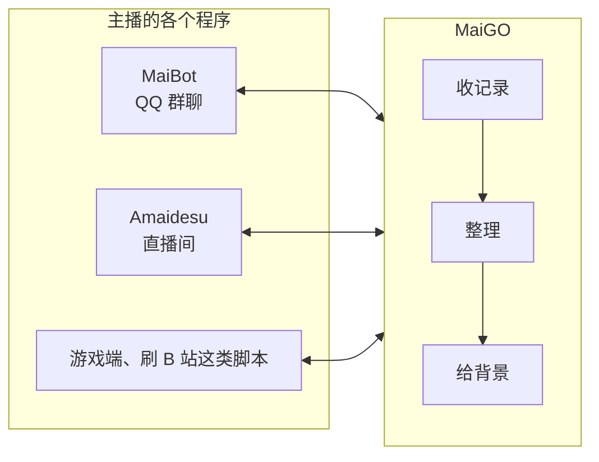
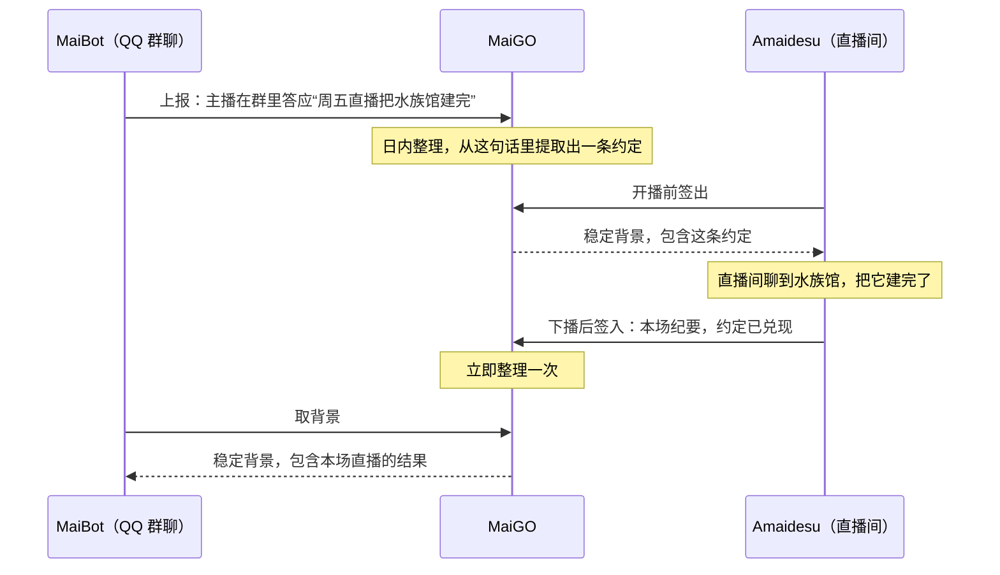
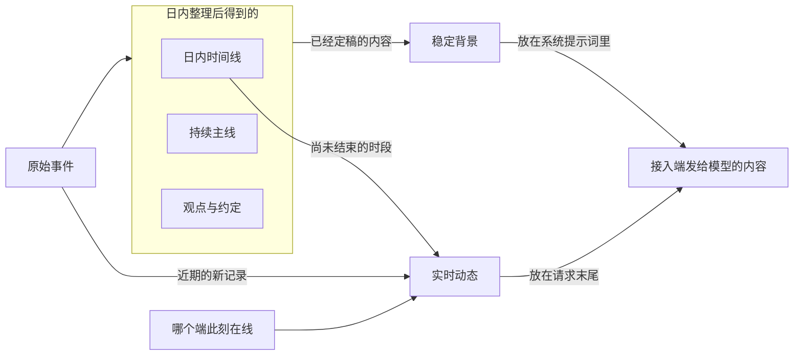

# MaiGO

MaiGO 是面向虚拟主播的共享记忆服务。主播的几个程序（群聊机器人、直播端、游戏端、各种脚本）将各自发生的事件上报给它，并在生成回复之前从它这里获取一段背景。这样主播无论在哪个程序里，都记得自己在别的地方做过什么、说过什么。

快速上手见[快速开始](#快速开始)。

## 解决什么问题

MaiGO 面向的场景里，一个虚拟主播的活动分散在几个程序里：MaiBot 在 QQ 群里聊天，Amaidesu 负责直播间，另有程序带着 Minecraft 存档，再加上刷 B 站、读 RSS 的脚本。这些程序各自启动、各自退出，记忆也各管各的。

于是会出现这种情况：主播在 QQ 群里答应观众“周五直播把水族馆建完”。到了周五开播，直播间里的程序对这件事一无所知，自然也不会提及。

MaiGO 的工作分三步：

1. 收记录。每个程序将各自发生的事件上报。每条记录称为一个原始事件，写明行为角色（主播本人、他人或系统）、发生场合和可见范围。
2. 整理。后台每隔一段时间执行一次日内整理，把原始事件归纳成以下几类记录。
3. 给背景。程序在生成回复之前，从 MaiGO 获取一段文字，放进自己的系统提示词。

整体结构如下图：



第 2 步整理出的记录有以下几类：

| 记录类型 | 说明 |
| --- | --- |
| 日内时间线 | 每天按上午、下午、晚上、深夜四段各写一段纪要；次日压缩为一段昨日摘要 |
| 持续主线 | 连续多日推进的事情，例如一个建了两周的存档 |
| 观点与约定 | 只从主播本人的发言和记录里提取。观点是态度，比如“手工区的视频比搞笑区耐看”；约定是答应别人的事，比如“周五直播把水族馆建完” |
| 话题池 | 日常浏览中发现、留待聊天时使用的素材 |
| 存档状态 | 每个游戏存档的最近进展 |

可见范围分为公开（`public`）、群聊（`group`）和私聊（`private`）三档，详见下文“隐私”一节。

## 上下文视图示例

从群里许诺到直播兑现，各程序与 MaiGO 的交互时序如下：



按上图场景上报示例经历后，直播端在“开播前签出”时拿到的 `stable_brief` 如下（过长的行在分号处做了换行）：

```text
【麦麦今天的经历】
- 今天上午（状态：轻松惬意）：在群聊答应大家周五直播把水族馆建完，当时说道「周五直播我把水族馆建完给你们看」；
  在公开场合刷到一条用粘土做水生生物摆件的视频，当时说道「我还是觉得手工区的视频比搞笑区耐看」。

【近期观点与偏好】
- 我还是觉得手工区的视频比搞笑区耐看（来自订阅浏览）

【跨端还惦记的约定】
- [约#1] 答应大家周五直播把水族馆建完（在QQ群答应）
```

“答应大家周五直播把水族馆建完”就是示例中主播在 QQ 群里说过的原话。直播端把这段文字放进系统提示词，主播开播时即可看到自己答应过什么。这段示例是未配置整理模型时由内置规则生成的；配置整理模型后，纪要由模型生成。

取背景的接口（`GET /api/v1/views/context`）每次返回两部分，接入端把它们放在提示词的不同位置：

- `stable_brief`（稳定背景）是已经定稿的内容：昨日摘要、今日已结束的时段、持续主线、观点与约定。没有新的定稿内容时，这段文字逐字节不变，模型服务的提示词缓存即可持续复用。
- `live_context`（实时动态）是正在发生的事：哪个端此刻在线、默认最近半小时内的新记录。它每次请求都可能不同，所以放在本轮请求的末尾。比如直播进行时，群聊端取到的实时动态是：

  ```text
  你此刻正在bilibili开直播（你自己是主播）《周五杂谈回》，当前环节：闲聊近况。
  【刚刚的动态】
  - 近期在公开场合：刷到一条用粘土做水生生物摆件的视频
  ```

两部分内容各自的来源：



一个时段结束时，该时段的纪要随即定稿并进入稳定背景，代码和 Web UI 中把这一步称为“封存”；直播端下播时调用的签入接口（见下文“接入”）也会立即定稿一次。MaiGO 的作息日从凌晨 4 点开始，该时间可以配置。

同一份响应还包含待聊话题和未兑现的约定；调用时声明当前在场的账号，还会返回每个人的脱敏提示（在场人物摘要）。

## 快速开始

需要 Python 3.12+ 和 [uv](https://docs.astral.sh/uv/)。构建 Web UI 还需要 Node.js 和 [pnpm](https://pnpm.io/)。

```powershell
# 安装依赖，准备配置文件
uv sync
Copy-Item config.example.toml config.toml

# 构建 Web UI。不执行这两行也能启动，只是没有网页界面
pnpm --dir dashboard install
pnpm --dir dashboard build

# 启动服务
uv run maigo serve --config config.toml
```

`Copy-Item` 是 PowerShell 的写法，Linux 和 macOS 上换成 `cp`。

启动之后：

- Web UI：<http://127.0.0.1:8768>
- 接口文档（可直接在页面中发请求）：<http://127.0.0.1:8768/docs>
- 健康检查：<http://127.0.0.1:8768/health>

### 最小示例

打开 Web UI 的「接入监控与调试」页，点击「示例：QQ 群约定」，再点击「提交并触发整理」。右侧的“上下文视图实时预览”会立即刷新，可以看到刚提交的事件和从中提取出的约定。

下面的脚本演示两个核心接口的调用：先上报一条事件，再模拟直播端获取一次背景。将内容保存为 `demo.py` 放在仓库根目录，运行 `uv run python demo.py`：

```python
import json
import time
import urllib.request

MAIGO = "http://127.0.0.1:8768"


def call(method, path, payload=None):
    """向 MaiGO 发一个 JSON 请求，返回解析后的响应。"""
    body = json.dumps(payload).encode("utf-8") if payload is not None else None
    request = urllib.request.Request(
        MAIGO + path,
        data=body,
        method=method,
        headers={"Content-Type": "application/json"},
    )
    with urllib.request.urlopen(request, timeout=5) as response:
        return json.loads(response.read())


# 1. 上报一条原始事件：主播本人在群里说了一句话
call(
    "POST",
    "/api/v1/events",
    {
        "idempotency_key": "my-first-event",  # 同一个 key 重复上报只会入库一次
        "branch_id": "maibot",
        "occurred_at_ms": int(time.time() * 1000),
        "kind": "speech",
        "actor_role": "self",
        "visibility": "group",
        "context_scope": "qq:group",
        "summary": "答应大家周五直播把水族馆建完",
        "verbatim": "周五直播我把水族馆建完给你们看",
    },
)

# 2. 模拟直播端在开播前取背景，只打印“实时动态”那一段
view = call("GET", "/api/v1/views/context?branch_id=amaidesu&target_visibility=public")
print(view["live_context"])
```

运行后打印：

```text
【刚刚的动态】
- 近期在群聊：答应大家周五直播把水族馆建完
```

未设置访问令牌时脚本可直接运行；设置了 `auth_token` 时，请求需附带该令牌。事件上报后不会立即被整理，约定需要等待整理运行后才会出现。整理的触发时机见下文“配置”中 `[synthesizer]` 的说明。

## 接入

每个接入端使用一个固定的 `branch_id` 标识自身（如 `maibot`、`amaidesu`），上报和取背景时都携带它。MaiGO 只负责记忆的读写，不参与任何一个程序的实时决策。

MaiGO 对各端是可选依赖：调用时设置较短的超时，服务未启动或中途不可用时，各端照常运行，只是暂时没有共享记忆。

**MaiBot（QQ 群聊）**

对应的接入插件是 MaiBot-MaiGO-Adapter，一个独立仓库，不改 MaiBot 本体的代码。插件自动上报主播在白名单群（以及可选的私聊）中的发言，并在每次生成回复之前把背景放入提示词。

**直播端、游戏端这类按场次启动的程序**

开播前调用一次签出接口 `POST /api/v1/sessions/checkout`，一次性获取本场所需的全部内容：稳定背景、未兑现的约定、待聊话题，以及跨端人物档案（哪些平台账号属于同一个人）。下播后调用一次签入接口 `POST /api/v1/sessions/{checkout_id}/checkin`，回传本场纪要、约定的进展以及人物互动。签入会立即触发一次整理，群聊端下次取背景时即可看到本场直播的结果。Amaidesu 的接入方式见协议文档第 4.1 节。

**自己写的脚本**

任何能发送 HTTP 请求的环境都可以接入，核心接口只有两个：`POST /api/v1/events` 上报事件，`GET /api/v1/views/context` 获取背景，上面的 `demo.py` 就是最小示例。同一个端口还提供 MCP 接口（`/mcp`），有三个工具：按关键词回忆、查询人物档案、将约定标记为已兑现或作废。

仓库里还有三个现成的脚本：

| 目录 | 做什么 |
| --- | --- |
| [`examples/rss_collector/`](examples/rss_collector/README.md) | 定时读取 RSS、Atom 订阅，将新文章上报给 MaiGO |
| [`examples/bilibili_browser/`](examples/bilibili_browser/README.md) | 通过 `bili` 命令行工具刷 B 站，将浏览内容上报给 MaiGO |
| [`examples/history_backfill/`](examples/history_backfill/README.md) | 将 MaiBot、Amaidesu 接入之前积累的聊天记录导入 MaiGO，可重复执行 |

## 隐私

- 每条原始事件都标注可见范围：`public`（公开）、`group`（群聊）或 `private`（私聊）。私聊内容只出现在一对一私聊的视图中，公开和群聊视图无法获取；群聊内容则会进入公开视图。
- 发送给模型的所有文字均经过脱敏，QQ 号、B 站 UID、群号、玩家 UUID 会被替换为“[账号已脱敏]”这类占位文字。
- 同一个人在不同平台的账号，仅在后台手动绑定或本人口令确认后合并，不会因昵称相同自动合并。
- 数据保存在本地的一个 SQLite 文件中（默认 `data/maigo.sqlite3`）。MaiGO 仅在配置了整理模型或向量模型时访问对应接口，此外不联网。

## 配置

配置写在 `config.toml`，每一项都有默认值，通常只需要关心下面几项。部分配置可以用环境变量覆盖，比如访问令牌对应 `MAIGO_AUTH_TOKEN`，整理模型对应 `MAIGO_LLM_BASE_URL`、`MAIGO_LLM_API_KEY`、`MAIGO_LLM_MODEL`，完整对应关系见 [`src/maigo/config.py`](src/maigo/config.py)。

| 配置项 | 说明 |
| --- | --- |
| `auth_token` | 访问令牌。仅本机使用时留空即可；需要局域网或公网访问时，填写长随机字符串 |
| `identity_salt` | 生成账号摘要用的盐。有人要求被遗忘时，库里只保留账号的加盐摘要，用来阻止之后再次收录。正式使用前请改成随机字符串 |
| `day_rollover_hour` | 作息日的切分小时，默认 4 |
| `[synthesizer]` | 可选的整理模型，需要 OpenAI 兼容接口，填写 `base_url`、`api_key`、`model` 三项。配置后日内时间线的纪要由模型生成，留空则使用内置规则。`persona_name` 是纪要里对主播的称呼，默认“麦麦” |
| `[embedding]` | 可选的向量模型，同样使用 OpenAI 兼容接口。配置后检索增加一路语义匹配，留空时仅使用 SQLite 全文检索 |
| `[backup]` | 自动备份，默认每天一次到 `data/backups`，保留 7 天 |

`[synthesizer]` 里还有整理的触发时机：未整理的原始事件累积到 `batch_event_threshold` 条（默认 8），或距上次整理超过 `min_interval_ms`（默认 15 分钟）时，触发一次整理。服务启动后的第一批事件会在 30 秒内处理。如需立即整理，可点击 Web UI 上的「立即整理」。

## Web UI

| 页面 | 功能 |
| --- | --- |
| 今日时间线 | 按日期查看各时段的纪要和原始事件；手动补录记录（快捷录入）；管理持续主线；将记录导出为 Markdown |
| 观点与话题 | 查看和修改观点与约定，例如将约定标记为已兑现；查看话题池，以及各话题已被哪些端消费 |
| 人物与账号 | 绑定同一个人在不同平台的账号；审核疑似同人候选；执行遗忘清除 |
| 接入监控与调试 | 查看各接入端的在线状态；投递测试事件；预览某个端在指定可见范围下收到的文字 |

## 命令行

`uv run maigo <子命令> --config config.toml`：

| 子命令 | 作用 |
| --- | --- |
| `serve` | 启动服务（默认子命令）；可用 `--host`、`--port` 覆盖监听地址 |
| `doctor` | 检查数据库是否完好，输出各表的记录数、当前的整理和检索模式、备份数量 |
| `backup` | 立即备份一次 |
| `export-diary` | 将最近几天的记录导出为 Markdown，例如 `--days 3 --visibility public` |

## 目录结构

```text
src/maigo/
├── main.py          # 命令行入口
├── config.py        # 配置
├── core/            # 日内整理、检索、人物档案、隐私过滤、背景生成
├── storage/         # SQLite 存储与表结构
└── server/          # HTTP 和 MCP 接口
dashboard/           # Web UI，Vue 3
examples/            # 接入示例脚本
tests/
docs/architecture/   # 架构和协议文档
```

## 开发

```powershell
uv run pytest       # 运行测试
uv run ruff check   # 代码检查
```

## 文档

- [术语表](CONTEXT.md)：代码、文档和 Web UI 中的名词及避用别名。
- [架构总览](docs/architecture/overview.md)：模块分层、数据存储、检索与缓存的工作方式。
- [开放协议与接入规范](docs/architecture/protocol.md)：全部接口的字段和调用顺序。
- [编码规范](AGENTS.md)：给贡献者和编码代理的约束。
