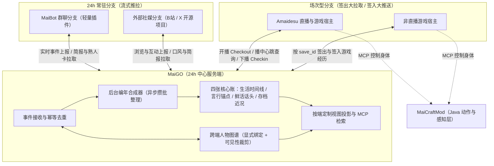

# MaiGO 架构总览

> `MaiGO` 是 24 小时独立运行的跨端记忆与生活流中心服务（寓「Mai + Ego」统一自我与「迷子」不再走散之意）。它将麦麦在群聊、直播、游戏与社交媒体上的碎片经历汇总合成为连贯的「一天」，消除多端言行冲突与熟人跨端失忆。
>
> **导航**：想了解拓扑边界、四张核心数据账与工程护栏，读本文；想查阅接口字段、签出/签入时序、各项目薄接入方案与第一版验收标准，读[开放协议与闭环规范](protocol.md)。

---

## 1. 问题本质与拓扑边界

### 1.1 为什么采用 24h 中心服务而非点对点插件

麦麦同时活跃在多个生命周期截然不同的运行环境中：`MaiBot` 7×24 小时常驻群聊，`Amaidesu` 仅在开播期间运行，未来还会接入外部开源的 B 站、X 等社媒冲浪与运营进程。点对点插件直连存在三个结构性瓶颈：

1. **缺乏中立的日内编年宿主**：插件寄生在单一业务进程内，无法独立于群聊会话模型把多渠道事件整理成完整的时间线；每增加一个新渠道，点对点适配呈 $N \times N$ 膨胀。
2. **内部模型被迫相互迁就**：将直播全量对话伪造成群消息回放以触发另一端的摘要机制，既产生高昂的冗余模型调用，又导致一端升级存储结构时另一端同步链路断裂。
3. **跨端缺乏统一立场与日常输入**：非直播时段缺乏日内经历沉淀，直播杂谈只能依赖静态手填卡片；麦麦在一端随口表达的观点或立下的约定无法同步到另一端，极易出现前后矛盾（左右脑互博）。

### 1.2 系统拓扑与职责边界

`MaiGO` 采用星型中心交换拓扑，核心原则是**「各端保实时决策闭环，中心保统一经历与身份」**：

**明确的不做事项**：

- **不接管各端实时大脑**：群聊的接话节奏、直播的低延迟控场仍由各端自身的规划器与回复器完成，`MaiGO` 不在任何一端的说话热路径上做阻塞式大模型推理。
- **不内置特定社媒爬虫或发帖业务**：B 站、X 等运营能力由外部独立开源项目承担，通过标准开放接口接入 `MaiGO`。
- **不修改游戏身体层**：`MaiCraftMod` 只对驱动它的宿主暴露动作与观察接口，游戏内的进展与玩家互动统一由宿主上报。

---

## 2. 核心数据模型：将无序经历映射为「一天」

若直接把各端原始聊天记录拼进提示词，既会迅速撑爆上下文并击穿前缀缓存，也无法阻止模型在杂乱信息中自相矛盾。`MaiGO` 通过后台异步运行的**编年合成器（`ChronicleSynthesizer`）**，将原始事件流收敛为四张结构化核心账。

### 2.1 原始经历流（`experience_events`）

所有接入分支上报的事实先进入只追加（Append-only）事件表，作为可追溯的唯一证据源：

- 按 `(branch_id, idempotency_key)` 幂等去重，网络重试不产生重复记录。
- 严格标注事件主体角色 `actor_role`：`self`（麦麦本人发出的台词、回复、评论、动态或亲手完成的游戏行为）、`peer`（群友、观众、玩家或社媒用户的互动）、`system`（开播、下播、换存档等状态事实）。
- 严格标注可见范围 `visibility`：`public`（公开直播间、公开评论区、公开推文）、`group`（受控粉丝群或多人联机服公屏）、`private`（私聊，最高隔离等级）。

### 2.2 四层记忆金字塔与核心账（v0.2）

| 记忆层级 | 底层存储 | 存什么 | 解决什么问题 / 消费方式 |
|---|---|---|---|
| **原始经历流** | `experience_events` | 全端只追加原子事实，带 `actor_role`、`visibility`、`save_id` 与全文索引 | 可追溯唯一证据源；支持子串、全文与语义关联召回 |
| **热层：日内生活时间线** | `daily_chronicles` | 按作息时段（上午 / 下午 / 晚上 / 深夜）滚动封存的第一人称纪要，附心情标签 `mood_tag` 与未完悬念 `unfinished_thread`；前一日压成 `yesterday_carry` | 让所有分支知晓「今天怎么过的、心境如何」；慢层进系统提示词扩展段，未封存窗口进快层；当日上午无记录且已有历史时，午后注入固定作息留白，同时保证同日 `brief_etag` 字节稳定 |
| **温层：近期连续主线** | `life_arcs` | 跨多天持续推进的项目、连续在玩的游戏存档、阶段性手艺或热议主题（含 `active` / `paused` / `completed` / `archived`） | 解决“昨天还在造铁路、今天像失忆”的跨日断层问题，取近期活跃主线精简投影到 `stable_brief` |
| **锚点层与话头/熟人账** | `persona_anchors`、`topic_seeds`、`persons`、`save_states` | 附 `self` 原话出处的观点（支持 `superseded_by_id` 观点演化取代链）与承诺（超 `stale_promise_days` 自动标 `stale` 衰减）；带分支消费轨迹的话头胶囊；显式绑定的脱敏熟人卡与存档近况 | 根治跨端前后打脸与兑现忘账，同时用状态演化保持慢层提示词精简不膨胀 |

### 2.3 后台编年合成节奏

编年合成器在 `MaiGO` 后台独立运行，不阻塞事件上报响应：

1. **增量触发条件**：未整理事件累积达到条数门槛、距离上次整理达到时间窗口，或收到场次型分支的「下播签入（Checkin）」信号时立即触发一轮合成。
2. **模型挑、代码验与自动后处理**：合成器优先调用可选 `[synthesizer]` 小模型归纳带心情与因果连贯的时段纪要，无配置或故障时回落确定性规则；代码层强制校验所有 `persona_anchors` 引用事件必须为 `actor_role="self"`，处理同类观点 `supersedes_id` 演化链并自动将超期承诺标为 `stale`，同时自动归并 `life_arcs` 温层主线与补齐语义向量索引。
3. **话头消费与自然衔接**：当某个 `topic_seed` 在群聊分支被使用后，记录消费轨迹 `consumed_branches=["maibot"]`；后续直播分支签出该话头时，渲染文本自动附带状态说明（如`「今天在群里提过一嘴，直播间还没细聊」`），引导麦麦自然说出连贯过渡语，而非当成全新初见重复背诵。
4. **跨日归档与每日热备份**：按配置的作息切日点（如凌晨 04:00）将前一日生活时间线压成单段「昨日余温」保留在次日慢层开头；当 `[backup].auto_daily = true` 且当天尚未备份时，自动执行一次 `VACUUM INTO` 一致性热备份并清理超期旧备份。

### 2.4 双路混合检索与外部方案评估边界

- **为什么借鉴 `A_memorix` 思路而不直接集成**：
  1. **许可证红线**：`A_memorix` 采用 `AGPL-3.0` 强传染许可证，直接作为依赖集成会污染本仓及外部集成端的许可边界。
  2. **运行拓扑冲突**：`A_memorix` 面向独立的 Python gRPC + Go Gateway + FAISS 多进程图谱服务，与 `MaiGO` 坚持的「单进程 FastAPI + 单文件 SQLite、零额外运维负担」定位不符。
  因此本项目仅在洁净室下吸收其分层检索与可观测设计理念，全部用已有轻量技术栈原味实现。
- **双路混合召回架构（`HybridRecallService`）**：
  - **稀疏路**：`experience_events_fts`（`unicode61`）+ `experience_events_trigram`（3 字及以上中文连续子串精确命中）+ 短词 `LIKE` 兜底 + 锚点/主线跨表召回。
  - **可选语义路**：配置 `[embedding]` 接口后，使用 `memory_embeddings` 表保存单机 `float32 BLOB` 向量并按 SHA-256 `content_hash` 幂等缓存；查询时用倒数排序融合（RRF）结合时间衰减与 `highlight` / `self` 权重排优，所有召回出口仍严格过滤 `visibility` 与 `forget_identities` 名单；未配置或外部接口异常时自动无感退回纯稀疏模式。

---

## 3. 关键工程护栏

### 3.1 快慢分层与提示词前缀缓存保护

`Amaidesu` 与 `MaiBot` 均重度依赖系统提示词的前缀缓存来压低首字延迟与推理成本。`MaiGO` 输出的上下文严格拆为两层：

- **慢层（`stable_brief`，面向系统提示词末尾）**：
  - 仅包含「昨日余温 + 今日已封存时段的纪要 + 当前生效的言行与承诺锚点」。
  - 已封存段落一旦生成即在当日内保持字节级不变；文本内只使用固定时段词（“今天上午”“今天下午”），绝不输出“10 分钟前”“刚刚”等随时间跳动的字样。
  - 仅当新时段封存或承诺状态变更时推进版本号 `brief_etag`。
- **快层（`live_context`，面向每轮末尾动态参考段）**：
  - 包含「此刻跨端在线状态（如正在 B 站直播某环节、刚下播不久）」「最近未封存窗口内的几条新动态」以及「本轮正在对话的那几位熟人的跨端近况」。
  - 放于请求尾部，随轮次按需变化而不破坏前部系统提示词缓存。

### 3.2 跨端认人与行为级防开盒

「跨端认出是同一个人」与「不在公开场合泄露他人隐私」在机制上分层解耦：

1. **确权才合并（零猜测）**：
   - `MaiGO` 仅在以下两种确权途径下将不同平台的外部账号归并至同一 `person_id`：① 运营者在看板或配置文件中显式绑定；② 用户本人通过跨端一次性口令完成自助绑定。
   - 昵称相同或相似、说话时间接近等弱信号最多进入看板「待审候选」，未经人工确认绝不自动打通。
2. **记忆互通，账号脱敏**：
   - 合并后，各端在查询或签出熟人名片时，只会收到统一的公开称呼与跨端共同经历摘要（例如：`「老熟人甲：今天下午刚在群里和你讨论过新模组，昨天在视频评论区留过言」`），所有原始平台 ID（QQ 号、B 站 UID、游戏 UUID）在投影出口由代码统一剥离。
3. **按目标场合裁剪可见性（`visibility` 矩阵）**：
   - 目标分支为**公开场合**（如 `Amaidesu` 直播间、公开评论区回复）：仅投影 `visibility="public"` 与经脱敏的 `"group"` 级公开互动梗，**100% 物理过滤 `"private"` 私聊事件**，并在行为提示中维持“不主动点破对方未公开的平台马甲与私事”的准则。
   - 目标分支为**同群场合**（如 `MaiBot` 白名单互通群）：可投影 `"public"` 与本群 `"group"` 经历。
   - 目标分支为**本人私聊**：可投影与该 `person_id` 本人相关的全量经历。
4. **一键遗忘联动**：任一端收到用户的遗忘/删除指令并上报 `MaiGO` 后，中心将该外部身份加入不记录摘要表并清除关联互动投影，确保跨端隐私合规闭环。

### 3.3 离线降级与故障隔离

- `MaiGO` 是增强层而非单点故障源。各接入端的 HTTP 请求均设短超时并保留最近一次成功拉取的本地快照。
- 当 `MaiGO` 重启或网络闪断时：各端写事件进入本地有界重试队列（或落本地待补文件），读视图直接使用本地缓存快照，对话与直播主链路零报错、零卡顿；恢复连接后按幂等键自动补齐。
