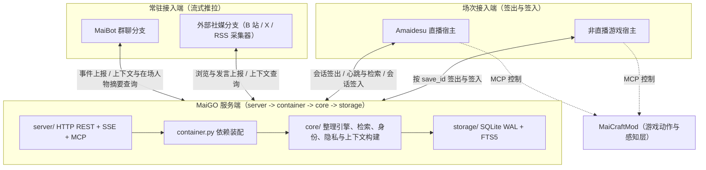

# MaiGO 架构总览

MaiGO 是常驻运行的跨端记忆与日常时间线服务，负责汇总群聊、直播、游戏和社交媒体等分支的经历，产出连贯的日内时间线、观点与约定、待聊话题以及跨端人物档案，同时向各接入端输出适配前缀缓存与可见性范围的上下文视图。

接口字段、请求时序与多端接入清单见[开放协议与接入规范](protocol.md)，全仓统一词汇定义见 [`CONTEXT.md`](../../CONTEXT.md)。

## 1. 拓扑与职责边界

### 1.1 为什么采用中心服务而非点对点插件

虚拟主播在不同生命周期的进程中并行活动：`MaiBot` 长期常驻群聊，`Amaidesu` 按直播场次启停，外部社媒工具按定时或事件触发运行。如果仅靠端到端插件直连：

1. 各端数据结构紧耦合，新接入一个渠道会让点对点同步代码成倍增加。
2. 将直播对话直接回放为群聊消息来触发另一端的摘要机制，会引入大量冗余模型调用，也容易在单端升级存储结构时破坏同步链路。
3. 非直播时段的浏览与发言缺乏统一归档，不同渠道对同一事件或同一对象的表述容易相互冲突。

### 1.2 系统拓扑

MaiGO 站在各业务端中间，只处理记忆沉淀、身份映射和视图投影，不接管任何一端的实时决策循环。



职责边界如下：

- 不介入群聊接话或直播低延迟控场的推理热路径。
- 不内置特定社媒平台的爬虫或自动发帖业务，外部项目通过标准 HTTP/MCP 接口读写数据。
- 不修改 `MaiCraftMod` 游戏端代码；游戏进度与玩家互动由驱动它的宿主按 `save_id` 上报。

## 2. 模块结构与单向依赖

代码树遵循严格的四层单向依赖（`server` → `container` → `core` → `storage`）：

```text
src/maigo/
├── main.py                  # CLI 入口（serve / doctor / backup / export-diary）
├── config.py                # 配置加载（环境变量优先于 TOML）
├── runtime.py               # 时钟注入与日志配置
├── container.py             # 应用依赖容器与广播中心装配
├── core/                    # 领域核心（无 HTTP 传输细节）
│   ├── models.py            # 共享数据模型（零 IO 叶子模块）
│   ├── privacy.py           # 可见性过滤与平台账号脱敏（零 IO 叶子模块）
│   ├── identity.py          # 跨端人物档案、显式绑定、口令与遗忘逻辑
│   ├── digest.py            # 日内整理引擎与后台调度器
│   ├── digest_rules.py      # 时段划分规则、规则抽取器与可选 LLM 客户端
│   ├── recall.py            # 全文 + 向量双路混合检索
│   ├── context.py           # 稳定背景与实时动态构建
│   └── maintenance.py       # 系统诊断、SQLite 热备份与记录导出
├── storage/                 # 持久化层（仅处理 SQLite 连接与表读写）
│   ├── db.py                # 单写锁调度器与 WAL 连接管理
│   ├── schema.py            # 表结构、FTS5 索引与触发器定义
│   ├── migrations.py        # Schema 版本升级脚本
│   └── repos/               # events / timeline / arcs / anchors / topics / persons / sessions / embeddings
└── server/                  # HTTP、SSE、MCP 与 Web 看板托管层
    ├── app.py               # FastAPI 装配与生命周期管理
    ├── auth.py              # Bearer 鉴权与请求上下文注入
    ├── schemas.py           # Pydantic 请求与响应契约
    ├── mcp.py               # Streamable HTTP MCP 服务端
    └── routes/
        ├── sync.py          # /health、事件上报、上下文视图、回忆检索、话题消费、SSE
        ├── sessions.py      # 会话签出、心跳与签入
        └── dashboard.py     # Web 看板管理接口
```

## 3. 数据分层与日内整理

直接向提示词拼接原始聊天记录会导致上下文过长并破坏前缀缓存。MaiGO 后台的整理引擎将原始事件归并到不同生命周期的结构化记录中。

### 3.1 数据记录层级

| 数据类型 | 存储表 | 内容与作用 | 主要用途 |
|---|---|---|---|
| 原始事件 | `experience_events` | 只追加原子事实，记录来源分支、`actor_role`、`visibility`、`save_id` 与全文索引 | 唯一证据溯源；全文与向量检索基础 |
| 日内时间线 | `daily_chronicles` | 按上午、下午、晚上、深夜归档的第一人称纪要，含情绪标注 `mood_tag` 与未完事项 `unfinished_thread`；跨日压缩为昨日摘要 `yesterday_carry` | 已封存段落构成稳定背景，未封存窗口进入实时动态 |
| 持续主线 | `life_arcs` | 跨多日持续推进的项目、游戏存档或主题（`active` / `paused` / `completed` / `archived`） | 保持长期事务连续性，活跃条目精简输出到稳定背景 |
| 观点与约定 | `persona_anchors` | 带有 `self` 原话出处的观点（`stance`，支持 `superseded_by_id` 演化替换）与约定（`promise`，超 `stale_promise_days` 自动标 `stale`） | 保持跨端表态一致；任一端兑现后全局销账 |
| 话题池 | `topic_seeds` | 携带摘要、主观评价和消费分支记录 `consumed_branches` 的待聊话题 | 为直播和群聊提供日常谈资，避免在不同分支机械复读 |
| 人物档案与存档状态 | `persons`、`save_states` | 显式绑定的跨平台人物记录及按 `save_id` 汇总的游戏世界近况 | 跨端识别联系人并延续跨宿主游戏进度 |

### 3.2 后台整理节奏与校验规则

整理引擎在后台异步运行，不阻塞写入请求：

1. 触发条件：未整理事件数量达到阈值、距上次整理超过间隔时间，或收到会话签入请求。
2. 提取与校验：配置外部小模型时，由模型生成带情绪和因果衔接的时段纪要；未配置或调用失败时自动使用规则引擎。代码层强制检验所有观点与约定必须引用 `actor_role="self"` 的原始事件，拦截来自外部用户的单方面发言。
3. 话题消费注记：当某条待聊话题被一个分支消费后，`consumed_branches` 记录该分支标识；向其他分支投影时附带来源说明，提示接入端自然衔接话题。
4. 跨日归档与自动热备份：到达配置作息切日点（默认凌晨 4:00）后，将前一日时间线压缩为次日的昨日摘要；若启用 `backup.auto_daily` 且当日尚无备份，则自动执行一次 `VACUUM INTO` 热备份。
5. 早间作息留白：当当日上午时段无任何事件且库中存在既有历史记录时，自下午起在稳定背景中注入固定的早间作息留白句，并且该提示在同一作息日后续时段保持字面不变。

### 3.3 双路混合检索与外部方案取舍

项目在设计检索与运维能力时参考了公开记忆项目（如 `A_memorix`）的分层召回思路，但未直接集成该依赖：上游仓库使用 `AGPL-3.0` 许可证且依赖独立的 gRPC、Go Gateway 与 FAISS 进程架构，与 MaiGO 的许可证约束及单进程 SQLite 部署原则冲突。MaiGO 在当前技术栈内独立实现了以下检索路径：

- 稀疏检索路：合并 `experience_events_fts`（`unicode61`）、`experience_events_trigram`（针对 3 字及以上中文子串）与短词 `LIKE` 兜底，并关联查询持续主线与观点约定。
- 可选语义向量路：配置 `[embedding]` 后，将向量以 `float32 BLOB` 写入 `memory_embeddings` 表并按文本 SHA-256 去重缓存；检索时采用倒数排序融合（RRF）叠加时间衰减及本人/高光权重。未配置向量接口或接口不可用时自动退回纯稀疏检索，并在所有出口执行 `visibility` 与遗忘名单过滤。

## 4. 前缀缓存、隐私隔离与降级策略

### 4.1 稳定背景与实时动态分离

为保证接入端系统提示词的前缀缓存命中率，`/api/v1/views/context` 与 `/api/v1/sessions/checkout` 输出拆分为两部分：

- 稳定背景（`stable_brief`）：置于系统提示词末尾，只含昨日摘要、当日已封存时段、近期持续主线与有效观点约定。文本内只出现固定时段名（例如“今天上午”），不包含随时间跳动的相对时间词；同日未发生新封存或锚点状态变更时，内容与 `brief_etag` 保持逐字节稳定。
- 实时动态（`live_context`）：置于单轮请求尾部，包含各分支当前在线状态、未封存窗口内的近期动态以及当前发言对象的在场人物摘要。

### 4.2 跨端人物识别与隐私隔离

识别身份与隐藏隐私分两层控制：

1. 显式确权绑定：跨平台账号仅通过后台手工绑定或用户一次性口令核销才归并到同一 `person_id`；昵称相似仅进入待审候选，不自动合并。
2. 账号标识脱敏：在面向模型的所有输出中，由 `core/privacy.py` 统一剥离 QQ 号、B 站 UID 与 Minecraft UUID，只保留公开称呼与跨端共同经历摘要。
3. 可见性矩阵：目标场合为 `public` 时严格排除所有 `private` 记录；`group` 场合仅返回 `public` 与 `group` 级事件；只有 `private` 一对一私聊可检索全量关联记录。
4. 遗忘清除：收到遗忘请求后写入摘要黑名单，停止后续采集并清除已有互动投影。

### 4.3 离线降级

MaiGO 作为增强服务运行在各接入端之外。接入端对 HTTP 请求配置短超时并缓存最近一次拉取结果；当服务重启或网络中断时，写入事件进入本地有界队列等待幂等重传，读取端沿用本地缓存继续运行，不影响对话与直播主链路。
