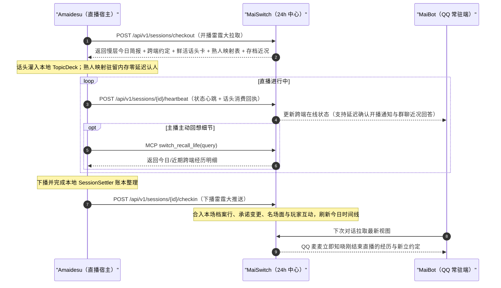

# 开放协议、多端接入与第一版闭环规范

> 本文定义 `MaiSwitch` 对外暴露的高兼容开放接口、`24h 流式` 与 `场次型签出/签入` 两种标准接入流程、`Amaidesu` 与 `MaiBot` 的零妥协薄接入映射、可视化看板功能边界，以及第一版（MVP）的可核验完成标准。架构背景与四张核心账见[架构总览](overview.md)。

---

## 1. 传输与通用约定

- **基础协议**：HTTP/1.1 JSON REST API（默认监听 `127.0.0.1:8768`，可配置）+ 同端口 `/mcp`（Streamable HTTP MCP 服务，供各端规划器按需挂载检索工具）+ `/api/v1/stream/notifications`（可选 SSE 轻量变更通知，推送 `brief_etag` 更新与跨端实时状态变化）。
- **鉴权**：配置 `auth_token` 非空时，所有 API 与 `/mcp` 校验请求头 `Authorization: Bearer <token>`；开发本机回环可按配置放行或使用统一令牌。
- **时间与标识**：所有时刻字段统一使用 Unix epoch 毫秒整数（`*_ms`）；所有写操作支持客户端传入 `idempotency_key`（字符串），服务端按 `(branch_id, idempotency_key)` 保证幂等。
- **分支身份（`branch_id`）**：任意接入项目通过自报稳定的小写标识区分来源，无需修改 `MaiSwitch` 代码即可横向扩展新渠道（如 `maibot`、`amaidesu`、`bilibili_ops`、`x_ops`、`mc_runner`）。

---

## 2. 统一事件信封（`ExperienceEvent`）

无论是群聊发言、直播整理成品、游戏存档进展，还是外部开源 B 站 / X 项目刷到的帖子与发出的评论，均通过同一结构上报：

```json
{
  "idempotency_key": "bili-comment-987654",
  "branch_id": "bilibili_ops",
  "occurred_at_ms": 1795488000000,
  "kind": "browsed",
  "actor_role": "self",
  "visibility": "public",
  "context_scope": "bilibili:video:BV1xx411c7mD",
  "actors": [
    {
      "platform": "bilibili",
      "external_id": "20002",
      "display_name": "某手工UP主"
    }
  ],
  "summary": "刷到用粘土捏萨卡班甲鱼的视频，并在评论区留言夸手艺逼真",
  "verbatim": "这个眼神简直一模一样，连呆滞感都还原出来了！",
  "reaction": "觉得很有亲切感，晚上直播杂谈可以跟大家聊聊手工翻车经历",
  "save_id": null,
  "metadata": {
    "source_title": "用粘土还原四亿年前的萨卡班甲鱼"
  }
}
```

**字段语义约束**：

- `kind`（封闭枚举）：
  - `speech`：麦麦本人在群聊、直播或评论区发出的关键表态、回复或动态（`actor_role` 必填 `self`，`verbatim` 填原话）。
  - `interaction`：与特定对象发生的有意义互动（对话往来、游戏切磋、送礼、答疑）。
  - `browsed`：刷社媒、看视频或读资讯获得的外部见闻（可附 `reaction` 主观感想与 `verbatim` 所留评论）。
  - `milestone`：场次级或任务级节点事件（开播、下播概览、游戏建成某设施或击败首领）。
  - `promise_update`：显式新增、兑现（`closed`）或作废（`void`）某条跨端约定。
  - `forget_request`：用户在某平台触发遗忘/删除请求，驱动跨端隐私擦除。
- `visibility`：`public` / `group` / `private`，缺省按分支安全默认档兜底（未声明时私聊分支默认 `private`）。
- `save_id`：仅游戏相关事件填写存档唯一标识，用于跨宿主对齐同一世界的进展。

---

## 3. 两种标准交换流程与接口契约

### 3.1 模式一：24h 常驻流式交换（适用于 `MaiBot` 及外部 B 站 / X 项目）

1. **上报事件**：`POST /api/v1/events`
   - 支持单条或批量数组（`{"events": [...]}`），校验落库后立即返回 `200 OK`（附接收条数与去重条数），后台异步触发编年合成。
2. **拉取实时投影视图**：`GET /api/v1/views/context`
   - 查询参数：`branch_id`、`target_visibility`（`public` / `group` / `private`）、`save_id`（可选）、`active_actors`（可选，如当前群聊刚发言的 `qq:10001,qq:10002`）、客户端已知慢层版本 `if_brief_etag`（可选）。
   - 返回结构清晰分离**慢层**与**快层**：
     - `brief_etag` + `stable_brief`（慢层纯文本：若与 `if_brief_etag` 相同则字段省略，调用端直接复用本地缓存，确保系统提示词前缀缓存不碎）；
     - `live_context`（快层纯文本：跨端当前活动状态，如“正在 B 站直播杂谈环节” + 近窗未封存新动态）；
     - `actor_cards`（针对传入 `active_actors` 命中的跨端已绑定熟人提示列表，无命中为空数组）；
     - `fresh_topics`（可选拉取的若干条未在本分支消费过的鲜活话头）。
3. **标记话头已聊**：`POST /api/v1/topics/{topic_id}/consume`
   - 请求体 `{"branch_id": "maibot"}`，记录该话头已在此分支展开聊过。

### 3.2 模式二：场次型签出与签入（适用于 `Amaidesu` 等按需启停端）



1. **开播签出（Checkout）**：`POST /api/v1/sessions/checkout`
   - 请求：`branch_id`、场次标识 `external_session_id`、可见性（直播固定 `public`）、标题、初始环节、计划进入的 `save_id`（可选）。
   - 响应一次性打包开播所需全套快照：
     - `checkout_id`：本场同步句柄；
     - `stable_brief`：截至开播前麦麦今日已发生的生活脉络与近期言行锚点；
     - `open_promises`：在群聊或其他端答应过、适合在直播间兑现或知晓的公开约定；
     - `topic_cards`：结构化鲜活话头列表（含 `seed_id`、标题、摘要、麦麦主观感想、已在何处提过的附注）；
     - `person_directory`：已确权绑定的跨端熟人轻量映射表（`platform + external_id -> 公开称呼 + 跨端近况一句话`，绝不含私聊隐私与原始账号）；
     - `save_brief`：若该游戏存档在非直播时段有跨宿主活动，返回期间的世界变更摘要。
2. **场中心跳与状态同步**：`POST /api/v1/sessions/{checkout_id}/heartbeat`
   - 上报当前是否在播、当前环节名、当前 `save_id` 以及刚被选用的 `consumed_seed_ids`；支持彩排场过滤（彩排场不触发跨端广播与签入入账）。
3. **下播签入（Checkin）**：`POST /api/v1/sessions/{checkout_id}/checkin`
   - 上报本场下播整理产出的结构化结晶：场次概览、本场新增档案行（含高光标记与原话）、新增/已兑现承诺、跨端熟人本场互动记录、游戏存档收尾摘要。
   - `MaiSwitch` 单事务落库并立即运行一次编年合成，使刚下播的经历无缝汇入「麦麦的今晚」。

### 3.3 标准 MCP 工具面（`/mcp`）

向支持 MCP 的各端规划器提供三个只读/轻量工具：

- `switch_recall_life(query: str, days: int = 7, limit: int = 5)`：基于 SQLite FTS5 与时间衰减混合检索跨端经历（如被问到“你下午在 B 站看的那个视频具体讲啥”时按需查原文）。
- `switch_lookup_person(platform: str, external_id: str)`：按平台与外部 ID 查询已绑定熟人的跨端往来（自动按调用方会话可见性裁剪）。
- `switch_resolve_promise(anchor_id: int, status: str, evidence: str)`：标记某条跨端约定已兑现或作废。

---

## 4. 各项目零妥协对接清单

### 4.1 `Amaidesu` 侧薄接入映射

保持 `Amaidesu` 现有四表账本与决策主循环不变，通过独立可开关的同步模块（`enabled = false` 时完全退回单机模式）完成接线：

1. **开播签出装填**：
   - `stable_brief` 拼入规划器记忆摘要的跨端生活扩展段（整场保持字节稳定，不破坏前缀缓存），回复器同步注入关键立场锚点；
   - `topic_cards` 映射为日常见闻话题卡注入 `TopicDeck`，主播在杂谈选用卡片后随下次心跳回调 `consumed_seed_ids`；
   - `person_directory` 缓存在场次内存中：当命中已绑定的观众弹幕或游戏玩家公屏发言时，在本地记忆线索（`MemoryCues`）附上一句跨端熟人近况（说话路径零网络 I/O）。同步更新 `Amaidesu` 侧关于跨端身份的决策口径：由原先“一刀切永不告知关联”调整为**“仅对确权绑定对象打通公开/群内记忆，严格屏蔽私聊与原始账号，行为上守住不公开点破未公开马甲”**。
2. **下播签入回推**：
   - 订阅下播整理完成节点，将已通过代码校验的本场档案行、承诺变更与高光直接调用 `checkin` 推给 `MaiSwitch`，不再推送整场原始弹幕流。

### 4.2 `MaiBot` 侧薄插件映射（`MaiBot-Switch-Adapter`）

`MaiBot` 主程序零改动，独立插件仓库承载以下轻量职责：

1. **出站自动采集**：挂接发送完成钩子，当麦麦在白名单互通群或私聊发出回复后，异步向 `POST /api/v1/events` 上报对话上下文摘要与麦麦原话（互通群标 `group`，私聊标 `private`），无需依赖模型手动调用记录工具。
2. **入站双层注入**：后台协程定期刷新慢层 `stable_brief` 本地缓存；在 `maisaka.planner.before_request` 与 `maisaka.replyer.before_request` 中，将 `stable_brief` 插入系统提示词后稳定位，将 `live_context` 与当前发言群友的 `actor_cards` 附在末尾动态提示位。
3. **保留群聊单嘴与开播喊人**：延续“群里只留 QQ 麦麦一张嘴”的体验——收到 `MaiSwitch` 广播的正式场稳定开播状态后，按配置延迟确认并唤醒 QQ 麦麦用自己的语气在通知群喊人；主播在直播间想往群里传话仍走托付机制。

### 4.3 外部 B 站 / X 开源项目接入约定

外部社媒项目无需感知 `MaiBot` 或 `Amaidesu` 的存在，仅需两步即可融入同一人格：

1. 生成评论、动态或推文前，请求 `GET /api/v1/views/context?branch_id=<id>&target_visibility=public` 获取麦麦今日生活脉络与近期立场锚点；
2. 浏览内容产生主观感想或发出评论/动态后，请求 `POST /api/v1/events` 上报 `browsed` 或 `speech` 事件。

---

## 5. 可视化看板（`dashboard/`）职责

`MaiSwitch` 内置轻量 Web 看板，既是日常运维控制面，也是直观检验「麦麦一天生活合成效果」的观测窗：

1. **今日生活时间线页**：按时间轴展示今日各时段合成纪要、当前跨端在线状态（哪几个分支在线、是否在播）及底层原始经历事件溯源。
2. **立场锚点与鲜活话头页**：展示自动提取的麦麦近期观点、跨端未兑现约定（支持人工编辑、了结、判误记）以及鲜活话头池（显示已在哪些分支聊过，支持人工投喂日常见闻卡）。
3. **跨端人物图谱页**：管理统一人物档案，支持手动绑定/解绑各平台账号、生成与核销自助绑定口令、审核疑似同人候选、查看某位熟人在不同可见性级别下的投影预览及执行隐私清除。
4. **分支监控与联调演练台**：展示各接入分支最近心跳与吞吐计数，提供一键模拟事件投递与多端视图预览器（输入分支与场合，实时预览模型将看到的慢层与快层完整文本）。

---

## 6. 第一版（MVP）可核验完成标准

第一版开发以跑通 **`MaiSwitch` 核心服务端 + 看板 + `MaiBot` 与 `Amaidesu` 双端真实闭环 + 外部社媒标准接入就绪** 为准绳，全部满足以下判据方可收口：

1. **核心存储与合成引擎完备**：
   - SQLite（WAL + FTS5）建表与版本迁移机制就绪，完整覆盖 `experience_events`、`daily_chronicles`、`persona_anchors`、`topic_seeds`、`persons`（含身份绑定、可见性过滤与遗忘名单）、`checkout_sessions` 与 `save_states`。
   - 编年合成器支持可注入 LLM 客户端与确定性代码护栏：非 `actor_role="self"` 的事件绝不产出麦麦立场或承诺；慢层 `stable_brief` 在无新封存段落时跨请求逐字节一致。
2. **开放协议与 MCP 服务全绿**：
   - 完整实现 `POST /api/v1/events`、`GET /api/v1/views/context`、`POST /api/v1/topics/{id}/consume`、`POST /api/v1/sessions/checkout`、`heartbeat`、`checkin`、人物绑定管理 API 及同端口 `/mcp` 三项工具，全部具备契约与边界测试（含幂等重试、`visibility` 严格隔离、原始平台账号剥离断言）。
3. **可视化看板可用**：
   - 看板四大核心页面（今日时间线、立场与话头、跨端人物图谱、分支监控与视图预览台）构建通过并与后端真实 API 联调打通。
4. **`Amaidesu` 与 `MaiBot` 薄接入端跑通**：
   - `Amaidesu` 侧完成可选 Switch 同步模块：开播签出装填简报、向 `TopicDeck` 注入鲜活话头卡、本地跨端熟人线索命中，以及下播整理后自动签入回推；`MaiSwitch` 离线时开播、决策与下播整理零异常降级。
   - `MaiBot` 插件侧完成 `MaiBot-Switch-Adapter`（通过假宿主与真实 MCP/HTTP 联调测试）：群聊/私聊发言自动按可见性上报、规划与回复双钩子正确注入慢快两层视图与群友跨端名片、正式场开播延迟喊人可用。
5. **全链路「麦麦的一天」端到端闭环验证通过**：
   - 自动化端到端验收测试完整跑通以下剧本并产出可查验报告：
     ① 模拟外部社媒分支上报一条“下午刷视频并留评论”的 `browsed/speech` 事件 →
     ② 同一位已绑定熟人在 `MaiBot` 群聊发言，群聊视图准确认出该熟人并带上视频经历，且群聊中麦麦答应晚上直播做某事并聊过该视频 →
     ③ `Amaidesu` 开播执行 `checkout`，拿到今日简报、群内许下的约定、带「群里已提过」附注的话头卡，且该熟人在直播间发弹幕时被认出（同时其私聊事件被 100% 拦在直播视图之外） →
     ④ `Amaidesu` 下播执行 `checkin` 回推本场档案与约定兑现状态 →
     ⑤ 回到 `MaiBot` 群聊拉取视图，群聊侧立即知晓刚才直播干了什么且已兑现约定不再重复催促。
