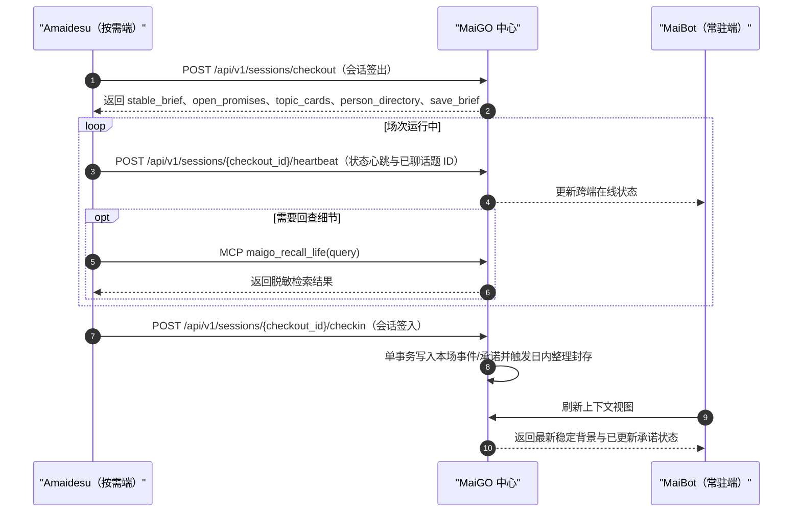

# MaiGO 开放协议与接入规范

本文档描述 MaiGO 对外提供的 HTTP REST、SSE 与 MCP 接口契约、`Amaidesu` 与 `MaiBot` 的边缘适配方式、Web 看板职责，以及集成验收标准。架构设计见[架构总览](overview.md)，术语定义见 [`CONTEXT.md`](../../CONTEXT.md)。

## 1. 传输约定

- 基础协议：HTTP/1.1 JSON REST API（默认监听 `127.0.0.1:8768`）、同端口 Streamable HTTP MCP 入口（`/mcp`）以及 SSE 通知流（`/api/v1/stream/notifications`）。
- 健康检查：`GET /health`（免鉴权）返回 `{"ok": true, "service": "maigo", "schema_version": 2, "synthesizer_mode": "llm|rule", "retrieval_mode": "hybrid|sparse"}`，用于探活与运行模式确认。
- 鉴权：当 `auth_token` 非空时，除 `/health` 与看板静态资源外的所有接口校验 `Authorization: Bearer <token>`。
- 时间与幂等：时间字段统一为 Unix epoch 毫秒整数（`*_ms`）；事件写入支持 `idempotency_key`，服务端按 `(branch_id, idempotency_key)` 幂等去重。
- 分支标识（`branch_id`）：各接入方使用稳定小写标识区分来源（例如 `maibot`、`amaidesu`、`bilibili_ops`、`x_ops`、`rss_collector`）。

## 2. 统一事件格式（`EventIn`）

各分支上报原始事件均使用同一 JSON 结构：

```json
{
  "idempotency_key": "bili-comment-987654",
  "branch_id": "bilibili_ops",
  "occurred_at_ms": 1795488000000,
  "kind": "browsed",
  "actor_role": "self",
  "visibility": "public",
  "context_scope": "bilibili:video:BV1xx411c7mD",
  "actors": [
    {
      "platform": "bilibili",
      "external_id": "20002",
      "display_name": "手工创作者甲"
    }
  ],
  "summary": "观看了粘土手工制作视频并在评论区留言",
  "verbatim": "这个造型细节还原得非常传神！",
  "reaction": "觉得手工过程很有趣，适合直播闲聊时分享",
  "save_id": null,
  "metadata": {
    "source_title": "用粘土制作水生生物摆件"
  }
}
```

关键字段约束：

- `kind`：可选值固定为 `speech`（本人发言或评论）、`interaction`（与他人互动）、`browsed`（浏览见闻）、`milestone`（场次或任务节点）、`promise_update`（约定新增或状态变更）、`forget_request`（遗忘请求）。
- `actor_role`：`self` / `peer` / `system`。仅 `self` 允许作为观点与约定的出处。
- `visibility`：`public` / `group` / `private`；省略时按 `context_scope` 安全回落，未标注的私聊场景默认归为 `private`。
- `save_id`：仅游戏相关事件填写，用于跨宿主对齐同一世界存档进度。

## 3. 标准交换接口

### 3.1 常驻端流式接口（`server/routes/sync.py`）

适用于 `MaiBot`、外部社媒脚本或 RSS 订阅采集器：

1. 上报事件：`POST /api/v1/events`
   接收单条事件或 `{"events": [...]}` 批量结构，幂等落库后返回接收与去重数量，并在后台唤醒整理引擎。
2. 拉取上下文视图：`GET /api/v1/views/context`
   查询参数包含 `branch_id`、`target_visibility`、`save_id`、`active_actors`（逗号分隔的 `platform:external_id`）、`if_brief_etag`、`include_topics`、`topic_limit`。
   返回字段包括：`brief_etag`、`stable_unchanged`、`stable_brief`（命中 `if_brief_etag` 时省略内容以保前缀缓存）、`live_context`、`actor_cards`（在场人物摘要）、`fresh_topics`、`open_promises`、`active_sessions`、`save_brief`。
3. 标记话题已使用：`POST /api/v1/topics/{topic_id}/consume`
   请求体 `{"branch_id": "maibot"}`，将该分支追加进 `consumed_branches`。
4. 混合回忆检索：`GET /api/v1/views/recall`
   查询参数为 `query`、`days`、`limit`、`target_visibility`，内部与 MCP 工具共用同一检索服务，返回脱敏后的文本汇总。
5. 状态变更订阅：`GET /api/v1/stream/notifications`
   以 SSE 推送 `events_ingested`、`brief_updated`、`presence_updated` 事件与保活注释帧。

### 3.2 场次型签出与签入（`server/routes/sessions.py`）

适用于 `Amaidesu` 等按场次启停的宿主进程：



1. 会话签出：`POST /api/v1/sessions/checkout`
   提交 `branch_id`、`external_session_id`、`kind`（`live` 或 `rehearsal`）、`visibility`、`title`、`platform`、`room_id`、`segment_title`、`save_id`，返回 `checkout_id` 与整场所需快照。
2. 会话心跳：`POST /api/v1/sessions/{checkout_id}/heartbeat`
   更新在播状态、当前环节、当前 `save_id` 并批量回写本轮选用的 `consumed_seed_ids`；`rehearsal` 彩排场次不向其他分支广播正式开播状态。
3. 会话签入：`POST /api/v1/sessions/{checkout_id}/checkin`
   提交本场概览、档案摘要（`archive_lines`）、约定更新（`promises`）、人物互动（`interactions`）及已聊话题 ID。若 `discarded=true` 或属于彩排场，仅结束会话而不污染当日时间线；正式场入库后立即执行一轮封存整理。

### 3.3 MCP 工具接口（`/mcp`）

通过 Streamable HTTP 暴露三个只读与状态核销工具：

- `maigo_recall_life(query, days=7, limit=5, target_visibility="public")`：检索近期原始事件、持续主线与观点约定。
- `maigo_lookup_person(platform, external_id, target_visibility="public")`：查询已绑定人物的脱敏档案与跨端共同经历。
- `maigo_resolve_promise(anchor_id, status, evidence="")`：将指定约定标记为 `closed` 或 `void`。

## 4. 外部项目接入约定

### 4.1 `Amaidesu` 同步模块（`[maigo_sync]`）

在保持 `Amaidesu` 原有四表模型和决策主循环不变的前提下接入：

- 开播签出：将 `stable_brief` 写入规划器背景段，把 `topic_cards` 注入话题池 `TopicDeck`，并将 `person_directory` 缓存在内存中供弹幕和游戏玩家发言零延迟匹配，同时遵循“关联记忆但不在公开场合点破未公开马甲”的提示约束。
- 场中与下播：心跳回写消费过的话题 ID；下播整理完成后调用 `checkin` 回传本场汇总与承诺状态。开关关闭或服务离线时直接退回单机流程。

### 4.2 `MaiBot` 适配插件（`MaiBot-MaiGO-Adapter`）

独立插件挂载消息钩子，不侵入 `MaiBot` 主仓库代码：

- 出站采集：在白名单互通群或私聊发送回复后，异步向 `POST /api/v1/events` 上报内容摘要与原话（`group` / `private`）。
- 双层上下文注入：后台定时拉取 `stable_brief` 缓存；在规划器与回复器钩子中将稳定背景置于系统提示词固定位，将 `live_context` 与 `actor_cards` 置于请求尾部动态位，并支持收到正式开播通知后延迟在通知群发言。

### 4.3 外部社媒端与 RSS 订阅采集器

外部 B 站 / X 运营项目发帖前拉取 `GET /api/v1/views/context?branch_id=<id>&target_visibility=public` 对齐近期背景与观点；浏览或发布评论后向 `POST /api/v1/events` 上报 `browsed` 或 `speech` 事件。

仓库在 [`examples/rss_collector/`](../../examples/rss_collector/README.md) 提供了无额外第三方依赖的 RSS 2.0 / Atom 订阅采集示例（仅用标准库与 `httpx`），默认按 `branch_id="rss_collector"` 将新条目以 `kind="browsed"` 上报。

## 5. Web 管理看板、运维接口与 CLI

看板通过 `dashboard/` 构建并托管在服务端根路径下，覆盖四个核心页面：

1. 今日时间线（`TimelineView.vue`）：支持按作息日切换查看各时段纪要、情绪标注与未完事项；包含**快捷录入**、**持续主线**管理（`GET/POST/PATCH/DELETE /api/v1/dashboard/arcs`）以及**记录导出** Markdown 面板（`GET /api/v1/dashboard/diary/export`）。
2. 观点与话题（`StancesTopicsView.vue`）：管理观点与约定（支持状态 `active`、`superseded`、`open`、`closed`、`stale`、`void` 及重新激活，`PATCH /api/v1/dashboard/anchors/{id}`）及话题池与消费轨迹。
3. 人物与账号（`PersonsView.vue`）：维护跨端人物档案、手工绑定或签发/核销自助口令、审核疑似同人候选、按可见等级预览模型所见文本以及执行遗忘清除。
4. 接入监控与调试（`MonitorView.vue`）：查看接入分支状态与心跳时间，投递调试事件并实时预览指定分支和可见等级下的稳定背景、实时动态与在场人物摘要。

顶栏同时对接 `GET /api/v1/dashboard/status` 展示整理/检索模式及 Schema 版本，并提供 `POST /api/v1/dashboard/backup` 触发在线热备份。

命令行工具（`uv run maigo ...`）支持四个子命令：

- `serve [--config ...] [--host ...] [--port ...]`：启动 HTTP、MCP 与看板服务（默认子命令）。
- `doctor [--config ...]`：输出 SQLite 完整性、表完整度、子系统模式与备份数量 JSON 报告。
- `backup [--config ...] [--out ...]`：执行一次 `VACUUM INTO` 一致性热备份并清理超期文件。
- `export-diary [--config ...] [--day YYYY-MM-DD] [--days N] [--visibility public|group|private]`：导出脱敏 Markdown 记录。

## 6. 集成验收标准

1. 存储与整理：SQLite WAL 与 FTS5 表及迁移脚本完整覆盖全部核心表；规则与可注入 LLM 整理路径均遵守非 `self` 不生成观点/约定的限制；无新封存段落时 `stable_brief` 字节一致。
2. 接口与权限：全部同步接口、签出/签入接口、看板运维接口与 `/mcp` 具备幂等、越权拦截、`visibility` 隔离及账号脱敏测试保障。
3. 看板构建：四个页面完成开发并可通过 `vue-tsc`、`vite build` 与静态资源托管测试。
4. 跨端闭环：自动化跨进程联调验证“社媒浏览事件 → QQ 群聊识别与立约 → 直播签出加载上下文与在场人物摘要 → 下播签入销账 → QQ 群聊回读更新”完整通路，且服务离线时各端正常运行。
